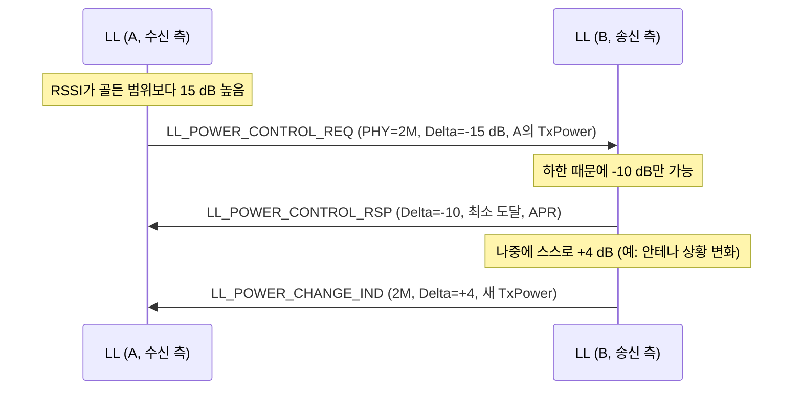

# LE 전력 제어

!!! spec "규격 · 버전"
    Core v6.0 Vol 6 Part B (Link Layer) — Power Control Request 절차, Power Change Indication 절차, 경로 손실 모니터링 · Vol 4 Part E (HCI) LE Power Control 관련 명령·이벤트
    Core 5.2 도입(LE Power Control, Path Loss Monitoring) · 이전에는 송신 전력이 연결 중 고정이거나 벤더 고유 방식

!!! basic "한눈에 보기"
    가까이 있는 사람에게 소리 지를 필요가 없듯, 연결된 두 기기도 **상대가 잘 들을 만큼만** 송신하면 됩니다.

    1. 수신 쪽이 받은 신호 세기(RSSI)를 보고 "너무 크다/작다"를 판단
    2. `LL_POWER_CONTROL_REQ`로 상대에게 "전력을 몇 dB 낮춰/올려 줘"라고 요청
    3. 상대는 할 수 있는 만큼 바꾸고 `LL_POWER_CONTROL_RSP`로 결과를 알림
    4. 스스로 전력을 바꿨을 때는 `LL_POWER_CHANGE_IND`로 통보

    이득: 배터리 절약, 주변 기기에 주는 간섭 감소, 가까울 때 수신기 포화 방지. 덤으로 **경로 손실**(송신 전력 − 수신 세기)을 알 수 있어 "가까워짐/멀어짐" 판단에 씁니다.

## 골든 수신 범위와 요청 { .l2 }

각 Controller는 자기 수신기가 가장 잘 동작하는 RSSI 구간, 이른바 **골든 수신 범위(golden receive power range)**를 구현에 맞게 정합니다. 받은 신호가 그보다 높거나 낮으면 상대에게 조정을 요청합니다.

| 수신 RSSI | 요청 | 기대 효과 |
|---|---|---|
| 범위 위(너무 셈) | 상대에게 전력 감소 요청 (음수 Delta) | 상대 전류·간섭 감소, 수신기 포화 방지 |
| 범위 안 | 요청 없음 | — |
| 범위 아래(너무 약함) | 상대에게 전력 증가 요청 (양수 Delta) | 패킷 오류·재전송 감소 |

| PDU | 방향 | 주요 필드 |
|---|---|---|
| `LL_POWER_CONTROL_REQ` | 양쪽 | PHY, **Delta**(요청하는 변화량, dB), 요청자의 현재 TxPower |
| `LL_POWER_CONTROL_RSP` | 응답 | 최소/최대 도달 표시, 실제 변화량, 응답자의 TxPower, **APR**(Acceptable Power Reduction) |
| `LL_POWER_CHANGE_IND` | 양쪽 | PHY 비트맵, 최소/최대 도달 표시, 변화량, 새 TxPower |

전력은 **PHY별로** 따로 관리합니다. 1M, 2M, Coded S=2, S=8에서 같은 거리라도 필요한 수신 세기가 다르기 때문입니다(수신 감도 요구: 1M·2M −70 dBm, S=2 −75 dBm, S=8 −82 dBm).

## 경로 손실 모니터링 { .l2 }

상대의 송신 전력을 알면 경로 손실을 구할 수 있습니다.

\[
\text{PathLoss} = \text{TxPower}_{\text{상대}} - \text{RSSI}
\]

Host는 높은·낮은 임계값과 **히스테리시스**를 설정하고, Controller는 경로 손실이 **low / middle / high** 영역 사이를 넘나들 때만 이벤트를 올립니다. 히스테리시스와 최소 머무름 시간 때문에 경계 근처에서 이벤트가 쏟아지지 않습니다.

| HCI | 종류 | 용도 |
|---|---|---|
| `HCI_LE_Enhanced_Read_Transmit_Power_Level` | 명령 | 내 현재·최대 송신 전력(PHY별) |
| `HCI_LE_Read_Remote_Transmit_Power_Level` | 명령 | 상대 송신 전력 조회 → LE Transmit Power Reporting 이벤트 |
| `HCI_LE_Set_Path_Loss_Reporting_Parameters` | 명령 | 높은/낮은 임계값, 히스테리시스, 최소 시간 |
| `HCI_LE_Set_Path_Loss_Reporting_Enable` | 명령 | 경로 손실 보고 켜기 |
| `HCI_LE_Set_Transmit_Power_Reporting_Enable` | 명령 | 내·상대 전력 변화 보고 켜기 |
| LE Path Loss Threshold | 이벤트 | 영역 변화(low/middle/high) 알림 |
| LE Transmit Power Reporting | 이벤트 | 전력 변화·조회 결과 |

??? expert "전문가 노트 — APR, 근접 응용, 구현 주의"
    **APR(Acceptable Power Reduction).** 응답 측이 "지금 수신 상태로 보아 네가 이만큼 더 낮춰도 괜찮다"는 여유를 알려 주는 값입니다. 요청자는 이를 참고해 자기 송신 전력을 스스로 줄일 수 있어, 왕복 요청 없이 양방향 최적화가 가능합니다.

    **근접 응용의 한계.** 경로 손실은 RSSI 기반이라 사람 몸·방향·다중 경로에 따라 수 dB 넘게 흔들립니다. "가까워지면 잠금 해제" 같은 기능의 대략적 영역 판단에는 쓸 수 있지만, 정밀 거리가 필요하면 [Channel Sounding](channel-sounding.md)이 맞습니다.

    **루프 안정성.** 양쪽이 동시에 서로를 조정하면 진동할 수 있어, 구현은 요청 간격에 최소 시간을 두고 RSSI를 여러 패킷 평균해 판단합니다. 전력 변경 직후 패킷의 RSSI는 판단에서 빼는 것이 일반적입니다.

    **규제·전력 등급과의 관계.** 최대 송신 전력은 Power Class(LE는 최대 +20 dBm)와 지역 규제가 상한을 정하고, 전력 제어는 그 안에서만 움직입니다 → [채널과 송신 전력](channels.md).

## Classic ↔ LE 비교

| 항목 | Classic (BR/EDR) | LE |
|---|---|---|
| 도입 | 1.x부터 LMP 전력 제어(증감 한 단계씩) | 5.2 LL 전력 제어 |
| 요청 단위 | 한 단계씩 올림/내림 | dB 단위 Delta, PHY별 |
| 경로 손실 보고 | 표준 HCI 없음 | Path Loss Monitoring 이벤트 |

## 관련 페이지
- [채널과 송신 전력](channels.md) — 전력 등급과 규제
- [무선 전파와 링크 버짓](../basics/radio-channel.md) — 경로 손실 모델
- [LL 제어 절차](ll-control.md) — 절차 충돌 규칙
- [저전력 설계 원리](../basics/low-power.md) — 송신 전력과 전류
- [Channel Sounding](channel-sounding.md) — 정밀 거리 측정
