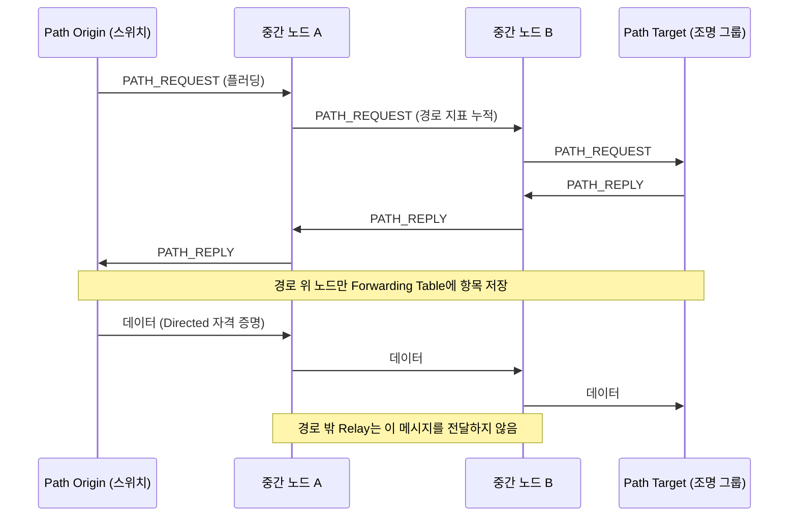

# Mesh 1.1

!!! spec "규격 · 버전"
    Mesh Protocol v1.1 · Mesh Model v1.1 · Mesh Device Firmware Update Model v1.0 · Mesh Binary Large Object Transfer Model v1.0 · Mesh Configuration Database Profile · NLC 프로파일 v1.0
    Mesh Profile 1.0 (2017.7) → 1.0.1 (오류 수정) → **Mesh Protocol 1.1** (SIG 발표 2023.9, 이름 변경 + 기능 확장)

!!! basic "한눈에 보기"
    2023년 9월 SIG는 Mesh 규격을 크게 확장하면서 기본 규격의 이름을 **Mesh Profile**에서 **Mesh Protocol**로 바꿨습니다(1.0은 "Profile" 이름 유지). 1.0이 "작은 조명 네트워크를 돌린다"였다면, 1.1은 **대규모 상업 건물 운용**을 겨냥합니다.

    1. **더 효율적인 전달** — Directed Forwarding, Subnet Bridge
    2. **더 쉬운 설치·유지보수** — Remote Provisioning, Device Firmware Update, Opcodes Aggregator
    3. **더 강한 보안·프라이버시** — Certificate-based Provisioning, Private Beacon, 새 프로비저닝 알고리즘

    1.1 노드는 1.0 노드와 같은 네트워크에서 함께 동작하며, 새 기능은 대부분 선택 사항입니다.

## 이름과 규격 구성 { .l2 }

| 1.0 시절 | 1.1 이후 | 내용 |
|---|---|---|
| Mesh Profile 1.0 / 1.0.1 | **Mesh Protocol 1.1** | 베어러~Access 계층, 프로비저닝, 보안, Foundation 모델. Model 계층 절 신설 |
| Mesh Model 1.0 / 1.0.1 | **Mesh Model 1.1** | Generic·Sensor·Time/Scene·Lighting 모델, 모델 메타데이터 |
| — | **Mesh Device Firmware Update Model 1.0** | 펌웨어 배포·업데이트 모델 |
| — | **Mesh Binary Large Object Transfer Model 1.0** | 큰 데이터(BLOB) 전송 모델 — DFU가 이를 사용 |
| — | NLC 프로파일 6종 | 상업용 조명 기기 유형별 필수 요구 → [모델](models.md) |

용어도 정리되어, 프로비저닝 대상 기기를 **Provisionee**라고 부르고 IV Index Recovery 설명이 서브넷 단위로 다듬어졌습니다.

## 1.1 신기능 { .l2 }

| 기능 | 해결하는 문제 | 핵심 동작 |
|---|---|---|
| **Remote Provisioning** | Provisioner 전파 범위 밖의 기기를 설치하려면 사람이 가까이 가야 했음 | 이미 프로비저닝된 노드(Remote Provisioning Server)가 대신 스캔·PB-ADV 링크를 맺고, 프로비저닝 PDU를 Mesh 메시지로 중계(**PB-Remote**). 노드 재프로비저닝(주소 변경·Composition 갱신·DevKey 재생성)도 지원 |
| **Device Firmware Update (DFU)** | 수백 개 노드 펌웨어를 하나씩 GATT로 올리기 어려움 | Initiator → **Distributor** → 여러 Updating 노드. BLOB Transfer로 멀티캐스트 전송, 백그라운드 진행 |
| **Directed Forwarding** | 플러딩은 Relay 수만큼 트래픽 증가 | 출발지–목적지 사이 **경로**를 찾아 그 경로 위 노드만 전달. 플러딩과 공존 |
| **Certificate-based Provisioning** | Static OOB 값 관리·유출 위험 | 기기 공개 키와 UUID를 담은 **X.509 인증서**로 기기 진위를 검증 |
| **Private Beacons** | Secure Network beacon의 Network ID·IV Index 노출로 추적 가능 | **Mesh Private beacon** — PrivateBeaconKey로 암호화하고 난수를 주기적으로 교체 |
| **On-Demand Private GATT Proxy** | Proxy가 늘 광고하면 전력·추적 문제 | 클라이언트가 **Solicitation PDU**를 보낼 때만 Private Network Identity로 광고 |
| **Subnet Bridge** | 서브넷 사이 통신하려면 NetKey를 공유해야 했음 | Bridging Table에 (서브넷·주소 쌍)을 등록해 선택적으로 중계 |
| **Opcodes Aggregator** | 설정 메시지 여러 개를 따로 보내 느림 | 여러 Access 메시지를 하나의 요청·응답으로 묶음 |
| **SAR Configuration** | 분할·재조립 타이머가 고정 공식 | SAR Transmitter/Receiver 상태를 노드별로 설정 |
| **Large Composition Data, Models Metadata** | 복잡한 기기의 Composition Data가 한 메시지에 안 들어감 | 페이지·오프셋 단위 읽기, 모델별 메타데이터 |
| **새 프로비저닝 알고리즘** | 16바이트 AuthValue와 CMAC 기반 확인 값 | `BTM_ECDH_P256_HMAC_SHA256_AES_CCM` (32바이트 AuthValue) |

## Directed Forwarding 동작 { .l2 }

경로는 필요할 때 만들어지고(on-demand), 일정 시간 쓰이지 않으면 사라집니다. 경로를 쓰는 메시지는 Directed 전용 보안 자격 증명으로 구분됩니다. 경로 탐색 실패나 1.0 노드만 있는 구간에서는 기존 관리형 플러딩으로 돌아갑니다.

??? expert "전문가 노트 — 도입 시 고려할 점"
    **혼합 네트워크.** 1.1 기능은 지원 노드 사이에서만 동작합니다. Directed Forwarding 경로 중간에 1.0 노드가 있으면 그 구간은 경로로 쓸 수 없고, Private beacon을 모르는 1.0 노드는 IV Update를 Secure Network beacon으로만 받습니다. 그래서 Private beacon만 켜고 Secure Network beacon을 끄는 구성은 모든 노드가 1.1일 때만 안전합니다.

    **DFU 역할.** Initiator(보통 앱·게이트웨이)가 이미지를 Distributor에 올리면, Distributor는 Firmware Distribution Server로서 Firmware Update Client·BLOB Transfer Client를 써서 대상 노드들(Firmware Update Server·BLOB Transfer Server)에 멀티캐스트로 배포합니다. LPN은 Friend를 통해 Pull 모드로 받을 수 있습니다. 메타데이터 검사로 "이 이미지가 이 노드에 맞는지"를 먼저 확인하고, 적용(apply)은 별도 단계로 분리됩니다.

    **원격 프로비저닝 범위.** Remote Provisioning Server가 스캔한 미프로비저닝 기기 목록을 Client에 보고하는 원격 스캔 절차가 있어, 앱은 건물 반대편 기기를 목록에서 골라 설치할 수 있습니다. 대신 프로비저닝 PDU가 여러 홉의 분할 메시지로 오가므로 직접 프로비저닝보다 시간이 깁니다.

    **기능별 규격 위치.** SIG의 요약 문서는 기능 목록 위주이며, 각 기능이 어느 규격(Protocol/Model/DFU/MBT)의 어느 절에 있는지는 원문 확인이 필요합니다.

## 관련 페이지

- [Mesh 개요와 관리형 플러딩](overview.md) — Directed Forwarding이 개선하는 플러딩
- [프로비저닝](provisioning.md) — PB-ADV·PB-GATT와 OOB
- [Mesh 보안](security.md) — Private beacon과 키 계층
- [모델](models.md) — NLC 프로파일
- [Matter·Thread와 Bluetooth](../next/matter-thread.md) — 다른 메시 기술과 비교
