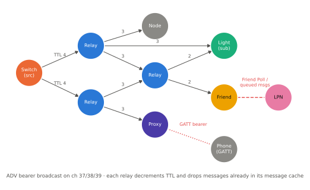
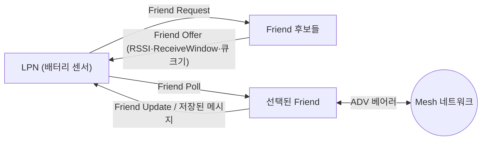

# Mesh 개요와 관리형 플러딩

!!! spec "규격 · 버전"
    Mesh Protocol v1.1 (2023, 이전 이름 Mesh Profile v1.0 — 2017) — 네트워크 계층, 노드 기능(Features), 주소 · Mesh Model v1.1 (모델 정의) · Core 4.0 이상 LE 컨트롤러 위에서 동작
    Mesh Profile 1.0 (2017.7) → 1.0.1 (오류 수정) → Mesh Protocol 1.1 (2023, Directed Forwarding 등 추가)

!!! basic "한눈에 보기"
    Bluetooth Mesh는 **라우팅 테이블이 없는** 메시 네트워크입니다. 메시지를 보내는 쪽은 광고 패킷으로 "주변 모두에게" 외치고, 들은 노드 중 **Relay** 기능이 켜진 노드가 다시 외쳐 줍니다. 이것을 **관리형 플러딩(managed flooding)**이라고 합니다.

    1. **TTL**: 메시지마다 "몇 번 더 전달해도 되는지"가 붙어 있어, 홉마다 1씩 줄고 바닥나면 더 퍼지지 않습니다.
    2. **메시지 캐시**: 이미 본 메시지는 다시 전달하지 않아 무한 반복을 막습니다.
    3. **역할 분담**: 전원이 있는 조명은 Relay·Proxy·Friend를, 배터리 스위치는 Low Power 노드를 맡습니다.
    4. **발행·구독**: 스위치는 "거실 그룹" 주소로 **발행**하고, 거실 조명들은 그 주소를 **구독**합니다. 스위치는 조명이 몇 개인지 몰라도 됩니다.

## 관리형 플러딩 { .l2 }

<figure markdown>

<figcaption>관리형 플러딩. 스위치가 TTL 4로 보낸 메시지를 Relay 노드가 TTL을 1씩 줄이며 다시 방송합니다. 같은 메시지가 여러 경로로 도착해도 메시지 캐시가 중복을 걸러 냅니다. Friend는 잠자는 LPN 대신 메시지를 보관하고, Proxy는 휴대폰과 GATT로 연결합니다.</figcaption>
</figure>

플러딩은 경로를 계산하지 않으므로 노드가 고장 나거나 옮겨져도 다른 Relay를 통해 메시지가 도착합니다. 대신 Relay가 많을수록 같은 메시지가 공중에 여러 번 나가므로, "어떤 노드에 Relay를 켤지"가 네트워크 설계의 핵심입니다.

| 장치 | 동작 |
|---|---|
| **TTL** (7비트) | 0 = 전달된 적도 없고 전달하지도 않음(1홉 이웃만), 1 = 이미 전달되었을 수 있으나 더 전달하지 않음(발신 노드는 TTL 1로 보내지 않음), 2–127 = 전달 가능. Relay는 TTL ≥ 2인 메시지만 TTL−1로 재전송 |
| **메시지 캐시** | (SRC, SEQ) 등으로 최근 메시지를 기억해 같은 메시지를 두 번 처리·전달하지 않음 |
| **Relay 재전송** | `Relay Retransmit` 상태(횟수·간격)로 같은 메시지를 몇 번 반복할지 설정 → 광고 충돌 대비 |
| **Network Transmit** | 발신 노드가 자기 메시지를 몇 번 반복 송신할지 |
| **Heartbeat** | 주기적 Heartbeat 메시지의 남은 TTL로 "몇 홉 떨어져 있는지"를 측정해 TTL 기본값 조정에 활용 |
| **Directed Forwarding** (1.1) | 플러딩 대신 경로 위 노드만 전달하는 선택 기능 → [Mesh 1.1](mesh-1-1.md) |

## 노드 기능 (Features) { .l2 }

모든 노드는 메시지를 보내고 받을 수 있습니다. 여기에 더해 각 노드는 아래 **선택 기능**을 갖출 수 있고, 기능 지원 여부는 Composition Data의 `Features` 필드로 알립니다.

| 기능 | 하는 일 | 주로 맡는 기기 |
|---|---|---|
| **Relay** | ADV 베어러로 받은 메시지를 TTL−1로 다시 방송 | 상시 전원 조명, 콘센트 |
| **Proxy** | ADV 베어러 ↔ GATT 베어러 중계. 휴대폰처럼 Mesh 스캔을 못 하는 기기가 GATT 연결로 참여 | 게이트웨이, 일부 조명 |
| **Friend** | 잠자는 LPN 앞으로 온 메시지를 대신 보관했다가 LPN이 물어보면(Friend Poll) 전달 | 상시 전원 노드 |
| **Low Power** (LPN) | Friend와 **friendship**을 맺고 대부분 시간 수신기를 끔. 주기적으로 깨어나 Poll | 배터리 센서, 스위치 |

## 주소와 발행·구독 { .l2 }

Mesh 주소는 16비트이며, 상위 비트로 종류가 갈립니다.

| 종류 | 범위 | 용도 |
|---|---|---|
| 미할당 (unassigned) | `0x0000` | 주소 없음(발행 꺼짐 등) |
| **유니캐스트** (unicast) | `0x0001`–`0x7FFF` | 노드의 각 요소(element)에 하나씩. 프로비저닝 때 할당. 최대 32,767개 |
| **가상** (virtual) | `0x8000`–`0xBFFF` | 128비트 **Label UUID**의 해시. 그룹을 사전 조율 없이 만들 때 |
| **그룹** (group) | `0xC000`–`0xFFFF` | 동적 그룹(`0xC000`–`0xFEFF`)과 고정 그룹: `0xFFFF` 모든 노드, `0xFFFE` 모든 Relay, `0xFFFD` 모든 Friend, `0xFFFC` 모든 Proxy (1.1: `0xFFFB` 모든 Directed Forwarding 노드) |

**발행(publish)**: 모델마다 하나의 발행 주소와 AppKey, TTL, 주기를 설정합니다. 상태가 바뀌면(예: 스위치 눌림) 그 주소로 메시지를 보냅니다.
**구독(subscribe)**: 모델마다 구독 목록(그룹·가상 주소)을 두고, 목록에 있는 주소로 온 메시지만 처리합니다. 설정은 Configuration Client가 `Config Model Publication Set`, `Config Model Subscription Add` 등으로 합니다.

??? expert "전문가 노트 — 플러딩 튜닝, 스캔 듀티, 확장성"
    **Relay 밀도.** 모든 상시 전원 노드에 Relay를 켜면 메시지 하나가 노드 수만큼 반복되어 광고 채널이 포화됩니다. 실무에서는 공간을 덮을 만큼만 Relay를 켜고, 나머지는 끄는 "Relay 선택"이 성능을 좌우합니다. 1.1의 Directed Forwarding은 이 문제를 경로 단위로 풉니다.

    **ADV 베어러의 수신 조건.** 노드는 광고 채널을 거의 100% 듀티로 스캔해야 메시지를 놓치지 않습니다. 그래서 상시 전원 노드와 LPN의 역할이 분리됩니다. 광고 충돌과 스캔 채널 전환 공백 때문에 단일 송신은 손실될 수 있어, Network Transmit·Relay Retransmit로 2–3회 반복하는 설정이 흔합니다(값은 제품·SDK 기본값 확인).

    **메시지 캐시 크기.** 규격은 캐시가 있어야 한다는 것만 요구하고 크기는 구현에 맡깁니다. 트래픽이 많은데 캐시가 작으면 오래된 메시지가 밀려나 다시 전달되는 "메아리"가 생깁니다.

    **재전송 공격 방지와 별개.** 메시지 캐시는 성능용입니다. 재전송(replay) 공격 방어는 SRC별 최신 SEQ/IV Index를 기억하는 **Replay Protection List**가 담당합니다 → [Mesh 보안](security.md).

    **확장 광고 미사용.** Mesh 1.x의 ADV 베어러는 레거시 광고 PDU(`ADV_NONCONN_IND`)에 실리며, 네트워크 PDU 최대 길이도 31바이트 광고 데이터에 맞춰져 있습니다.

## 관련 페이지

- [프로비저닝](provisioning.md) — 노드가 주소와 NetKey를 받는 과정
- [네트워크·전송·접근 계층](layers.md) — 네트워크 PDU와 분할·재조립
- [모델](models.md) — 발행·구독되는 메시지의 내용
- [Mesh 1.1](mesh-1-1.md) — Directed Forwarding, Subnet Bridge
- [레거시 광고](../le/legacy-advertising.md) — ADV 베어러가 쓰는 광고 PDU
- [Matter·Thread와 Bluetooth](../next/matter-thread.md) — Thread·Zigbee와의 비교
