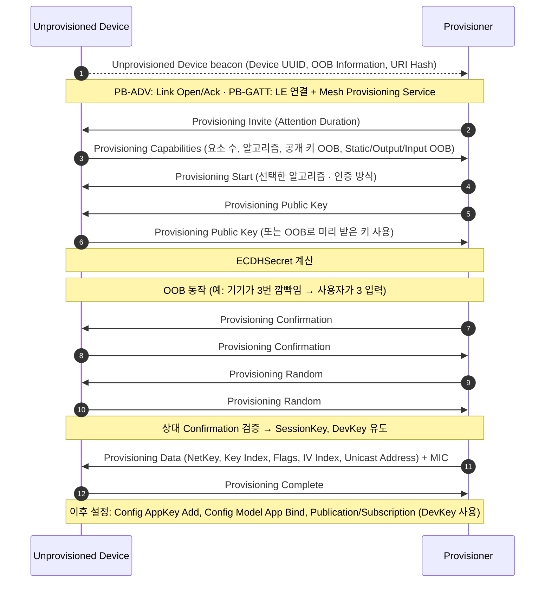

# 프로비저닝

!!! spec "규격 · 버전"
    Mesh Protocol v1.1 — Mesh Provisioning (프로비저닝 프로토콜, PB-ADV, PB-GATT, PB-Remote) · Core v6.0 Vol 3 Part C (GAP, 광고) · Mesh Provisioning Service(GATT) 정의 포함
    Mesh Profile 1.0 (2017): PB-ADV/PB-GATT, P-256 ECDH + AES-CMAC → Mesh Protocol 1.1 (2023): HMAC-SHA256 알고리즘, 인증서 기반 프로비저닝, 원격 프로비저닝 추가

!!! basic "한눈에 보기"
    **프로비저닝(provisioning)**은 아직 네트워크에 속하지 않은 기기(**Unprovisioned Device**, 1.1 용어로 **Provisionee**)를 Mesh **노드**로 만드는 절차입니다. 보통 휴대폰 앱이 **Provisioner** 역할을 합니다.

    1. **Beaconing** — 새 기기가 "나 여기 있어요"라고 자기 UUID를 광고
    2. **Invitation** — Provisioner가 초대하고, 기기는 자기 능력(요소 수, 지원 인증 방식)을 알림
    3. **Exchange Public Keys** — 양쪽이 P-256 공개 키를 교환해 ECDH 공유 비밀을 만듦
    4. **Authentication** — 전구 깜빡임 횟수 입력, 라벨의 QR 값 등 **OOB** 정보로 "중간자 없음"을 확인
    5. **Distribution of Provisioning Data** — 암호화된 채널로 NetKey, IV Index, 유니캐스트 주소를 전달

    끝나면 기기는 노드가 되고, 양쪽만 아는 **DevKey**가 생깁니다. AppKey 추가와 모델 바인딩은 그 뒤 **설정(configuration)** 단계에서 DevKey로 보호된 메시지로 합니다.

## 프로비저닝 절차 { .l2 }

| 단계 | PDU | 주요 내용 |
|---|---|---|
| Beaconing | Unprovisioned Device beacon | 16바이트 **Device UUID**, 2바이트 OOB Information(라벨·QR·NFC 등 어디에 OOB 정보가 있는지), 선택적 URI Hash |
| Invitation | `Provisioning Invite` / `Provisioning Capabilities` | Attention Timer(기기가 깜빡여 "저 기기"임을 알림), 요소 수, 지원 알고리즘, OOB 방식·크기 |
| 방식 결정 | `Provisioning Start` | 알고리즘, 공개 키 전달 방식(인밴드/OOB), 인증 방식과 동작·크기 |
| 공개 키 교환 | `Provisioning Public Key` | P-256 공개 키 X, Y (각 32바이트) |
| 인증 | `Provisioning Confirmation` / `Provisioning Random` (`Provisioning Input Complete`) | 먼저 커밋(Confirmation)하고 나중에 난수 공개 → AuthValue를 모르면 통과 불가 |
| 데이터 배포 | `Provisioning Data` / `Provisioning Complete` | 25바이트 데이터(NetKey 16 · Key Index 2 · Flags 1 · IV Index 4 · Unicast Address 2) + 8바이트 MIC, SessionKey로 AES-CCM 암호화 |
| 실패 | `Provisioning Failed` | 오류 코드(잘못된 PDU, 확인 실패, 자원 부족 등) |

## PB-ADV와 PB-GATT { .l2 }

프로비저닝 PDU를 나르는 **프로비저닝 베어러(PB)**는 두 가지(1.1에서 원격 방식 추가)입니다.

| 항목 | **PB-ADV** | **PB-GATT** |
|---|---|---|
| 전송 수단 | 광고 패킷 (AD Type `PB-ADV`) | LE 연결 + GATT (Mesh Provisioning Service `0x1827`) |
| 링크 관리 | Generic Provisioning 계층: `Link Open`(Device UUID) / `Link Ack` / `Link Close`, 4바이트 Link ID | LE 연결 자체가 링크 |
| 분할 | Transaction Start/Continuation + Transaction Ack | Proxy PDU의 SAR, 특성 `Mesh Provisioning Data In`/`Out` |
| 필요 조건 | Provisioner가 광고 스캔·송신 가능 | 휴대폰처럼 GATT만 쓰는 Provisioner |
| 기기 지원 | 프로비저닝을 지원하는 기기는 필수 | 선택 (휴대폰 앱 대상 제품은 사실상 필수) |
| 1.1 추가 | **PB-Remote** — 이미 프로비저닝된 노드(Remote Provisioning Server)를 거쳐 멀리 있는 기기를 프로비저닝 → [Mesh 1.1](mesh-1-1.md) | |

## OOB 인증 방식 { .l2 }

| 방식 | 동작 | 보안 수준 |
|---|---|---|
| **No OOB** | AuthValue = 0 | 중간자 공격 방어 없음. 공개 키 교환 순간을 노린 MITM 가능 |
| **Static OOB** | 기기에 고정된 값(라벨·QR·제조사 DB) 사용 | 값이 유출되지 않는 한 양호. 1.1 HMAC 알고리즘에서는 32바이트 |
| **Output OOB** | 기기가 출력(깜빡임, 비프, 진동, 숫자·문자 표시) → 사용자가 Provisioner에 입력 | 출력 자릿수(Output OOB Size)가 작으면 추측 공간이 작음 |
| **Input OOB** | Provisioner가 값을 보여 주고 사용자가 기기에 입력(버튼 누르기, 돌리기, 숫자·문자) | Output과 같음 |
| **OOB 공개 키** | 기기 공개 키를 QR 등으로 미리 받음 | 공개 키 교환 단계의 MITM 차단 |

??? expert "전문가 노트 — 키 유도, 알고리즘, 알려진 취약점"
    **키 유도.** `ConfirmationInputs`(Invite·Capabilities·Start PDU 내용과 양쪽 공개 키)를 `s1`로 해시해 ConfirmationSalt를 만들고, ECDHSecret과 함께 ConfirmationKey를 얻습니다. 이후 ProvisioningSalt = `s1`(ConfirmationSalt ‖ RandomProvisioner ‖ RandomDevice)를 써서 `k1` 함수로 SessionKey(`"prsk"`), SessionNonce(`"prsn"`), **DevKey**(`"prdk"`)를 유도합니다. DevKey는 Provisioner와 노드만 압니다.

    **두 가지 알고리즘.** 1.0의 `BTM_ECDH_P256_CMAC_AES128_AES_CCM`(16바이트 AuthValue)에 더해, 1.1은 `BTM_ECDH_P256_HMAC_SHA256_AES_CCM`(32바이트 AuthValue, HMAC-SHA256 기반 확인 값)을 추가했습니다. 기기는 Capabilities의 Algorithms 비트로 지원 여부를 알립니다.

    **알려진 공격.** 2021년 공개된 Mesh 프로비저닝 관련 취약점(CVE-2020-26556·26557·26559·26560 등)은 AuthValue를 추측하거나 상대의 Confirmation·공개 키를 반사·도용해 인증을 통과하는 시나리오였습니다. 대응은 ① 고정·재사용되는 Static OOB 피하기, ② 상대 공개 키가 자기 것과 같으면 거부, ③ 충분히 긴 무작위 AuthValue와 1.1의 HMAC 알고리즘 사용입니다(세부 권고는 SIG 보안 공지 확인).

    **실무 흐름.** 앱은 프로비저닝 직후 DevKey로 `Config Composition Data Get`을 보내 요소·모델 목록을 읽고, `Config AppKey Add` → `Config Model App Bind` → `Config Model Publication Set`/`Config Model Subscription Add` 순으로 설정합니다. 노드 수가 많을 때 이 단계가 시간 대부분을 차지하며, 1.1의 Opcodes Aggregator가 이를 줄입니다.

    **Attention Timer.** Invite의 Attention Duration 동안 기기는 깜빡임 등으로 자신을 드러냅니다. 같은 제품 여러 개 중 하나를 고를 때 사용자 확인 수단입니다.

## Classic ↔ LE ↔ Mesh 비교

| 항목 | LE 페어링 | Mesh 프로비저닝 |
|---|---|---|
| 대상 | 두 기기 사이 링크 | 기기 ↔ 네트워크 전체 |
| 키 교환 | P-256 ECDH (LE Secure Connections) | P-256 ECDH |
| 인증 | Just Works / Passkey / Numeric Comparison / OOB | No OOB / Static / Output / Input OOB |
| 결과 | LTK(링크 암호화), IRK, CSRK | NetKey, DevKey, 유니캐스트 주소, IV Index |

## 관련 페이지

- [Mesh 보안](security.md) — 프로비저닝으로 받은 키의 쓰임
- [Mesh 1.1](mesh-1-1.md) — 원격·인증서 기반 프로비저닝
- [LE 페어링과 본딩](../security/le-pairing.md) — 비교 대상인 LE 페어링
- [GATT](../host/gatt.md) — PB-GATT가 쓰는 서비스·특성 구조
