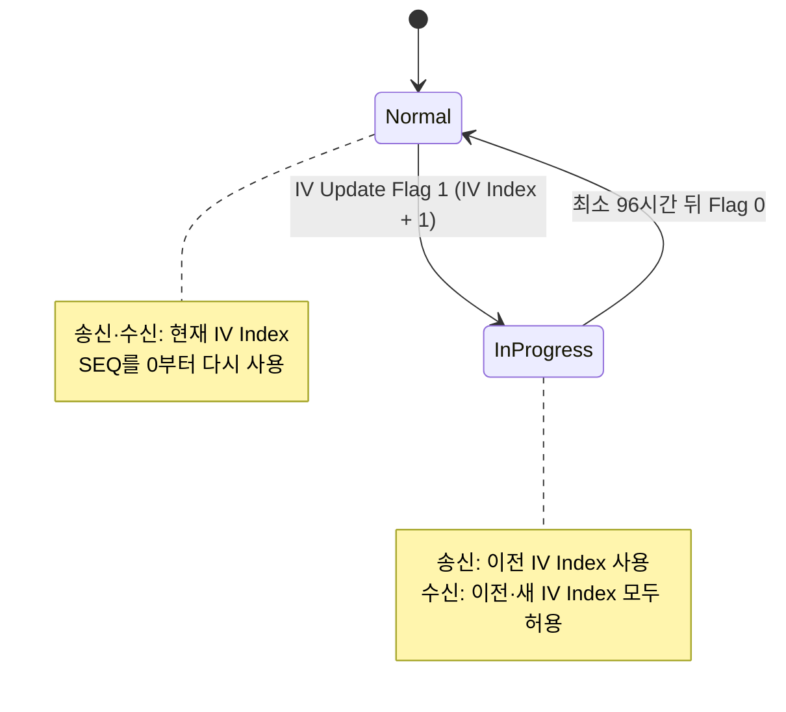

# Mesh 보안

!!! spec "규격 · 버전"
    Mesh Protocol v1.1 — Mesh Security (키, 보안 툴박스 함수 s1·k1–k4, 메시지 보안), IV Update 절차, Key Refresh 절차, Secure Network beacon · Mesh Private beacon (1.1)
    Mesh Profile 1.0 (2017): NetKey·AppKey·DevKey, IV Update, Key Refresh → Mesh Protocol 1.1 (2023): Mesh Private Beacon, 인증서 기반 프로비저닝, HMAC-SHA256 프로비저닝 알고리즘

!!! basic "한눈에 보기"
    Mesh는 모든 메시지를 **두 겹**으로 보호합니다.

    1. **NetKey (네트워크 키)** — 네트워크의 모든 노드가 공유. Relay가 메시지를 "이 네트워크 것"으로 확인하고 전달할 수 있게 함
    2. **AppKey (응용 키)** — 특정 응용(조명, 출입문 등)에만 배포. Relay는 AppKey가 없으므로 **내용을 볼 수 없음**
    3. **DevKey (기기 키)** — Provisioner와 노드 한 쌍만 앎. 키 배포 같은 설정 메시지 전용

    비유하면 NetKey는 건물 출입증, AppKey는 층별 사무실 열쇠, DevKey는 관리자와 개인 사이의 금고 비밀번호입니다. 여기에 **SEQ + IV Index**로 재전송 공격을 막고, **키 갱신(Key Refresh)**으로 버린 기기를 네트워크에서 내보냅니다.

## 키 계층 { .l2 }

| 키 | 범위 | 유도되는 값 | 보호 대상 |
|---|---|---|---|
| **NetKey** (128비트) | 서브넷 전체. Key Index 12비트 → 노드당 최대 4096개 | `k2` → **NID**, **EncryptionKey**, **PrivacyKey** · `k3` → **Network ID** · `k1` → **IdentityKey**, **BeaconKey** (1.1: PrivateBeaconKey) | 네트워크 PDU 암호화(NetMIC), 헤더 난독화, 비컨 인증, Proxy 광고 |
| **AppKey** (128비트) | 하나의 NetKey에 묶임. Key Index 12비트 | `k4` → **AID**(6비트) | Upper Transport 암호화(TransMIC). 모델 단위로 바인딩 |
| **DevKey** (128비트) | 노드 하나 | 프로비저닝 중 ECDH 공유 비밀에서 유도 | Configuration 모델 메시지 (키 추가·삭제, 발행 설정) |

**서브넷(subnet)**: NetKey 하나가 하나의 서브넷을 정의합니다. 호텔이라면 객실마다 다른 NetKey를 쓰고, 관리 노드만 여러 NetKey를 가질 수 있습니다. 1.1의 **Subnet Bridge**는 키 공유 없이 서브넷 사이 메시지를 선택적으로 넘깁니다.

**프라이버시 키(PrivacyKey)**: 네트워크 PDU의 CTL·TTL·SEQ·SRC를 난독화해, 엿듣는 사람이 같은 SRC·연속 SEQ로 기기를 추적하지 못하게 합니다. 암호화가 아니라 "추적 방해"입니다.

## IV Index와 IV 업데이트 { .l2 }

각 요소의 **SEQ**는 24비트(약 1,677만)이며 메시지마다 1씩 늘어나고 재사용할 수 없습니다. 논스는 SEQ와 32비트 **IV Index**로 만들므로, SEQ가 고갈되기 전에 네트워크 전체가 IV Index를 1 올려야 합니다. 이것이 **IV Update 절차**입니다.

| 항목 | 내용 |
|---|---|
| 알림 수단 | **Secure Network beacon**(BeaconKey로 인증, Flags에 Key Refresh·IV Update 비트, Network ID, IV Index 포함) 또는 1.1의 **Mesh Private beacon** |
| 상태 유지 시간 | Normal ↔ In Progress 각 상태에 최소 96시간 머무름 |
| `IVI` 비트 | 네트워크 PDU 헤더의 IV Index 최하위 비트 → 전환 중 어느 IV Index로 복호할지 판별 |
| IV Index Recovery | 오래 꺼져 있던 노드가 비컨으로 현재 IV Index를 따라잡는 절차 (허용 범위 제한 있음) |
| Replay Protection List | SRC별 마지막 (IV Index, SEQ)를 저장. 더 작거나 같은 값은 버림. 크기는 Composition Data의 `RPL` 최소값으로 알림 |

## 키 갱신과 노드 제거 { .l2 }

고장 난 전구를 버리면, 그 전구의 플래시에는 NetKey와 AppKey가 그대로 남아 있습니다. 누군가 쓰레기통에서 주워 키를 꺼내면 네트워크에 메시지를 보낼 수 있습니다. 이것을 **Trash-can 공격**이라고 부릅니다. 대응은 **노드 제거 + 키 갱신**입니다.

| 단계 | Key Refresh Phase | 동작 |
|---|---|---|
| 0. 노드 제거 | — | 가능하면 `Config Node Reset`으로 기기 키 삭제. 이미 버렸다면 Provisioner의 노드 목록에서 제외(제외 목록에 기록) |
| 1. 새 키 배포 | Phase 1 | 남은 노드에만 DevKey로 `Config NetKey Update`, `Config AppKey Update` 전송. 송신은 **옛 키**, 수신은 옛·새 키 모두 |
| 2. 새 키로 전환 | Phase 2 | Secure Network beacon의 Key Refresh Flag 또는 `Config Key Refresh Phase Set`. 송신은 **새 키**, 수신은 둘 다 |
| 3. 옛 키 폐기 | Phase 3 → 0 | 옛 키 삭제. 제거된 노드는 새 키를 모르므로 더는 참여 불가 |

새 키는 각 노드의 **DevKey**로 암호화해 개별 전달하므로, 제거된 노드는 NetKey를 알고 있어도 새 키를 받을 수 없습니다. 노드 수가 많으면 시간이 오래 걸리며, LPN은 Friend를 통해 받습니다.

??? expert "전문가 노트 — 툴박스 함수, 논스, 운용 실수"
    **보안 툴박스.** 모든 유도는 AES-CMAC 기반 함수로 합니다: `s1`(솔트 생성), `k1`(일반 유도, 예: DevKey·IdentityKey), `k2`(NID·EncryptionKey·PrivacyKey; Friendship 자격 증명도 같은 함수에 LPN·Friend 주소와 카운터를 넣어 만듦), `k3`(64비트 Network ID), `k4`(6비트 AID). 1.1의 HMAC 기반 프로비저닝 알고리즘은 확인 값 계산만 바꾸고 이 툴박스는 그대로 씁니다.

    **논스 종류.** Network nonce, Application nonce, Device nonce, Proxy nonce가 있고(1.1에서 Proxy solicitation nonce 추가), 모두 SEQ·SRC·IV Index를 포함합니다. 같은 키와 논스 조합을 재사용하면 AES-CCM 보안이 깨지므로, 노드는 SEQ를 전원 차단에도 잃지 않도록 비휘발 메모리에 주기적으로(블록 단위로 앞당겨) 저장해야 합니다.

    **Friendship 자격 증명.** Friend ↔ LPN 사이 메시지는 NetKey에서 Friend 주소·LPN 주소·두 카운터로 유도한 별도 자격 증명을 쓸 수 있습니다. Friend가 저장해 둔 메시지를 다른 노드가 흉내 내기 어렵게 합니다.

    **흔한 운용 실수.** ① 모든 제품에 같은 Static OOB를 써서 프로비저닝 인증이 무력화됨, ② AppKey 하나를 모든 모델에 바인딩해 권한 분리가 사라짐, ③ 노드를 앱에서만 지우고 Key Refresh를 하지 않음, ④ 공장 초기화 시 SEQ·RPL을 지우지 않아 재프로비저닝 후 메시지가 거부됨.

## Classic ↔ LE ↔ Mesh 비교

| 항목 | LE (연결) | Mesh |
|---|---|---|
| 보호 단위 | 링크(두 기기) | 네트워크(NetKey) + 응용(AppKey) |
| 암호 | AES-CCM (LL) | AES-CCM 두 겹 (Network, Upper Transport) |
| 재전송 방지 | 패킷 카운터(링크별) | SEQ + IV Index + Replay Protection List |
| 키 폐기 | 본딩 삭제 | Key Refresh 절차 |
| 추적 방지 | RPA | 헤더 난독화, (1.1) Private beacon·Private Identity |

## 관련 페이지

- [프로비저닝](provisioning.md) — DevKey와 첫 NetKey를 받는 과정
- [네트워크·전송·접근 계층](layers.md) — NetMIC·TransMIC가 붙는 위치
- [Mesh 1.1](mesh-1-1.md) — Private beacon, 인증서 기반 프로비저닝
- [프라이버시와 RPA](../security/privacy.md) — LE의 추적 방지와 비교
- [알려진 공격과 대응](../security/attacks.md) — Bluetooth 전반의 공격 사례
