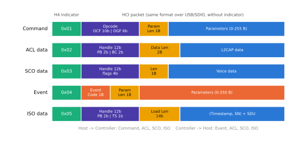
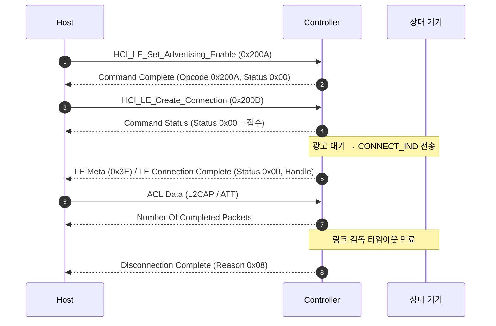

# HCI 명령과 이벤트

!!! spec "규격 · 버전"
    Core v6.0 Vol 4 Part E (HCI Functional Specification: 명령·이벤트·데이터 패킷) · Vol 4 Part A (UART 전송, H4) · Vol 4 Part B (USB 전송) · Vol 1 Part F (Controller Error Codes)
    Core 1.1 HCI 정의 → 4.0 LE 명령군(OGF 0x08)·LE Meta 이벤트 → 5.0 확장 광고·확장 연결 명령 → 5.2 ISO 데이터 패킷(0x05) → 6.x Channel Sounding 등 명령 추가

!!! basic "한눈에 보기"
    **HCI**(Host Controller Interface)는 Host(스택)와 Controller(무선 칩) 사이의 표준 대화 규칙입니다. 손님(Host)이 주방(Controller)에 주문서를 넣고, 주방이 "주문 접수"나 "요리 완성" 쪽지를 돌려주는 식당과 비슷합니다.

    1. Host가 **명령(Command)**을 보냅니다. 예: "광고 시작", "이 주소로 연결".
    2. Controller는 바로 끝나는 명령에는 **Command Complete**, 오래 걸리는 명령에는 먼저 **Command Status**로 "접수"만 알립니다.
    3. 일이 끝나거나 상대가 무언가를 하면 Controller가 **이벤트(Event)**를 올립니다. 예: "연결됨", "광고 보고", "연결 끊김(이유 0x08)".
    4. 실제 데이터는 **ACL**(L2CAP 데이터), **SCO**(Classic 음성), **ISO**(LE Audio 등시성) 패킷으로 오갑니다.

## 패킷 종류 { .l2 }

<figure markdown>

<figcaption>UART(H4)에서는 맨 앞 1바이트 지시자로 패킷 종류를 구분합니다. USB에서는 지시자 없이 엔드포인트(제어·인터럽트·벌크·등시)로 구분합니다.</figcaption>
</figure>

| H4 지시자 | 패킷 | 방향 | 헤더 | 최대 파라미터/데이터 길이 |
|---|---|---|---|---|
| `0x01` | Command | Host → Controller | Opcode 2 B + 길이 1 B | 255 B |
| `0x02` | ACL Data | 양방향 | Handle·PB·BC 2 B + 길이 2 B | Controller 버퍼 크기 (`HCI_LE_Read_Buffer_Size`로 확인) |
| `0x03` | Synchronous (SCO) Data | 양방향 | Handle·상태 2 B + 길이 1 B | 255 B |
| `0x04` | Event | Controller → Host | Event Code 1 B + 길이 1 B | 255 B |
| `0x05` | ISO Data | 양방향 | Handle·PB·TS 2 B + 길이 2 B | Controller ISO 버퍼 크기 |

### Opcode = OGF + OCF

명령 Opcode는 16비트이며 상위 6비트가 **OGF**(Opcode Group Field), 하위 10비트가 **OCF**(Opcode Command Field)입니다.

\[
\text{Opcode} = (\text{OGF} \ll 10) \;|\; \text{OCF}
\]

예: LE 명령군 OGF = 0x08, `HCI_LE_Create_Connection`의 OCF = 0x000D → \(0x08 \ll 10 = 0x2000\), Opcode = **0x200D**. 와이어에는 리틀 엔디언이므로 `0D 20`으로 보입니다.

| OGF | 그룹 | 예 |
|---|---|---|
| 0x01 | Link Control | `HCI_Disconnect` (0x0406), `HCI_Create_Connection` (0x0405) |
| 0x02 | Link Policy | `HCI_Sniff_Mode` (0x0803) |
| 0x03 | Controller & Baseband | `HCI_Reset` (0x0C03), `HCI_Set_Event_Mask` (0x0C01) |
| 0x04 | Informational | `HCI_Read_Local_Version_Information` (0x1001), `HCI_Read_BD_ADDR` (0x1009) |
| 0x05 | Status Parameters | `HCI_Read_RSSI` (0x1405) |
| 0x08 | LE Controller | 아래 표 |
| 0x3F | Vendor Specific | 칩 벤더 전용 (펌웨어 패치, 송신 전력 설정 등) |

## 자주 쓰는 LE 명령과 이벤트 { .l2 }

| 명령 | Opcode | 응답 | 용도 |
|---|---|---|---|
| `HCI_LE_Set_Event_Mask` | 0x2001 | Complete | 받을 LE 서브이벤트 선택 |
| `HCI_LE_Read_Buffer_Size` | 0x2002 | Complete | ACL 버퍼 길이·개수 |
| `HCI_LE_Set_Advertising_Parameters` | 0x2006 | Complete | 레거시 광고 간격·종류·채널 맵 |
| `HCI_LE_Set_Advertising_Data` | 0x2008 | Complete | 광고 데이터(최대 31 B) |
| `HCI_LE_Set_Advertising_Enable` | 0x200A | Complete | 레거시 광고 시작/중지 |
| `HCI_LE_Set_Scan_Parameters` / `_Enable` | 0x200B / 0x200C | Complete | 레거시 스캔 |
| `HCI_LE_Create_Connection` | 0x200D | **Status** | 연결 시작 (Initiating) |
| `HCI_LE_Create_Connection_Cancel` | 0x200E | Complete | 연결 시도 취소 |
| `HCI_LE_Connection_Update` | 0x2013 | **Status** | 연결 파라미터 갱신 |
| `HCI_LE_Enable_Encryption` | 0x2019 | **Status** | LTK로 암호화 시작 (Central) |
| `HCI_LE_Set_Data_Length` | 0x2022 | Complete | DLE 요청 |
| `HCI_LE_Set_PHY` | 0x2032 | **Status** | 2M·Coded PHY 전환 |
| `HCI_LE_Set_Extended_Advertising_Parameters` | 0x2036 | Complete | 확장 광고 세트 설정 |
| `HCI_LE_Set_Extended_Advertising_Enable` | 0x2039 | Complete | 확장 광고 시작 |
| `HCI_LE_Extended_Create_Connection` | 0x2043 | **Status** | PHY별 파라미터로 연결 |

| 이벤트 | 코드 | 의미 |
|---|---|---|
| Disconnection Complete | 0x05 | 연결 종료 + **Reason** 오류 코드 |
| Encryption Change | 0x08 | 암호화 켜짐/꺼짐 (실패 시 Status) |
| Command Complete | 0x0E | 명령 완료 + 반환 파라미터 |
| Command Status | 0x0F | 명령 접수(Status = 0x00) 또는 거부 |
| Hardware Error | 0x10 | Controller 내부 오류 |
| Number Of Completed Packets | 0x13 | ACL 버퍼 반환 (흐름 제어) |
| **LE Meta** | 0x3E | LE 서브이벤트 묶음 (아래) |

| LE 서브이벤트 | 코드 | 의미 |
|---|---|---|
| LE Connection Complete | 0x01 | 연결 성립(또는 실패 Status) |
| LE Advertising Report | 0x02 | 레거시 광고 수신 |
| LE Connection Update Complete | 0x03 | 새 간격·지연·타임아웃 적용 |
| LE Long Term Key Request | 0x05 | Peripheral에게 LTK 요청 |
| LE Remote Connection Parameter Request | 0x06 | 상대가 파라미터 변경 요청 |
| LE Data Length Change | 0x07 | DLE 결과 |
| LE Enhanced Connection Complete | 0x0A | RPA 정보 포함 연결 완료 |
| LE PHY Update Complete | 0x0C | PHY 전환 결과 |
| LE Extended Advertising Report | 0x0D | 확장 광고 수신 |
| LE Advertising Set Terminated | 0x12 | 광고 세트 종료(연결·타임아웃) |

## Command Complete / Status 흐름 { .l2 }

Command Complete와 Command Status에는 `Num_HCI_Command_Packets` 필드가 있어, Host가 지금 몇 개의 명령을 더 보내도 되는지 알려 줍니다(명령 흐름 제어). Command Status의 Status가 0이 아니면 그 명령은 **시작조차 되지 않은 것**이고, 나중 이벤트는 오지 않습니다.

## 오류 코드 { .l2 }

오류 코드는 명령의 Status, 연결 종료 Reason, LL·LMP 거부 사유에 공통으로 쓰입니다.

| 코드 | 이름 | 실무에서 흔한 원인 |
|---|---|---|
| 0x01 | Unknown HCI Command | Controller가 지원하지 않는 명령 (버전·기능 확인) |
| 0x02 | Unknown Connection Identifier | 이미 끊긴 Handle로 명령 |
| 0x05 | Authentication Failure | 페어링·키 불일치 |
| 0x06 | PIN or Key Missing | 상대가 본딩 키를 지움 → 재암호화 실패 |
| 0x07 | Memory Capacity Exceeded | Controller 자원 부족 |
| 0x08 | **Connection Timeout** | 감독 타임아웃 만료: 거리·간섭·상대 전원 차단·클럭 문제 |
| 0x0C | Command Disallowed | 현재 상태에서 허용되지 않는 명령 (예: 광고 중 파라미터 변경) |
| 0x0D | Connection Rejected due to Limited Resources | 연결 수·버퍼 한계 |
| 0x12 | Invalid HCI Command Parameters | 범위 밖 파라미터 |
| 0x13 | **Remote User Terminated Connection** | 상대가 정상적으로 끊음 |
| 0x16 | **Connection Terminated By Local Host** | 내 Host가 `HCI_Disconnect`로 끊음 |
| 0x1A | Unsupported Remote Feature | 상대가 기능(DLE, 2M 등) 미지원 |
| 0x1F | Unspecified Error | 원인 미상 — 스니퍼로 확인 |
| 0x22 | LMP Response Timeout / LL Response Timeout | 제어 절차 응답이 40 s 안에 오지 않음 |
| 0x23 | LMP Error Transaction Collision / LL Procedure Collision | 양쪽이 동시에 제어 절차 시작 |
| 0x28 | Instant Passed | 갱신 시점(instant)을 이미 지나 받음 |
| 0x2A | Different Transaction Collision | 서로 다른 절차 충돌 |
| 0x3B | Unacceptable Connection Parameters | 요청한 연결 파라미터 거부 |
| 0x3C | Advertising Timeout | 고속 지향성 광고·광고 기간 만료 |
| 0x3D | Connection Terminated due to MIC Failure | 암호화 패킷 무결성 실패 (키 불일치·버그) |
| 0x3E | **Connection Failed to be Established / Synchronization Timeout** | 연결 직후 첫 패킷을 6 연결 간격 안에 못 받음, 주기적 광고 동기 실패 |

??? expert "전문가 노트 — 이름이 같은 숫자, 흐름 제어, VS 명령"
    **0x3E가 두 번 나온다.** 이벤트 코드 0x3E는 LE Meta 이벤트이고, 오류 코드 0x3E는 "Connection Failed to be Established"입니다. 로그에서 "0x3E"를 볼 때 어느 필드의 값인지 먼저 확인해야 합니다.

    **0x3E의 정확한 뜻.** Central이 `CONNECT_IND`를 보낸 뒤, 연결이 확정되려면 처음 6개 연결 이벤트 안에 상대 패킷을 받아야 합니다. 그렇지 못하면 Controller가 연결을 실패로 처리하고 Reason 0x3E로 Disconnection Complete를 올립니다. 대개 Peripheral이 `CONNECT_IND`를 받지 못했거나(광고 채널 간섭), 전송 창(transmit window)에서 서로 타이밍이 어긋났거나, 수면 클럭 정확도(SCA)가 실제보다 좋게 신고된 경우입니다.

    **ACL 흐름 제어.** Host는 `HCI_LE_Read_Buffer_Size`로 받은 패킷 수만큼만 보내고, `Number Of Completed Packets` 이벤트로 돌려받은 만큼 다시 보낼 수 있습니다. 이 카운트가 새면 데이터가 멈춘 것처럼 보이는 "ACL credit 고갈" 버그가 됩니다.

    **명령 시간 초과.** HCI 규격 자체에는 Host 쪽 명령 타임아웃 값이 없습니다. BlueZ·Android 등은 각자 수 초 단위의 타임아웃을 두고, 넘으면 Controller를 리셋합니다. 로그에 `HCI_Reset`이 갑자기 보이면 이 경우를 의심합니다.

    **Vendor Specific(OGF 0x3F).** 펌웨어 패치 다운로드, 송신 전력·주파수 보정, 공존 설정이 이 경로로 갑니다. 이름이 표준화되어 있지 않아 Wireshark가 해석하지 못하므로 벤더 문서가 필요합니다.

## Classic ↔ LE 비교

| 항목 | Classic (BR/EDR) | LE |
|---|---|---|
| 연결 명령 | `HCI_Create_Connection` (0x0405) | `HCI_LE_Create_Connection` (0x200D), `HCI_LE_Extended_Create_Connection` (0x2043) |
| 연결 완료 이벤트 | Connection Complete (0x03) | LE Meta 0x3E / 서브이벤트 0x01·0x0A |
| 페이지/광고 실패 | 0x04 Page Timeout | 0x3E Connection Failed to be Established |
| 페어링 이벤트 | Host가 IO Capability·User Confirmation 이벤트 처리 | SMP는 Host가 ACL(L2CAP CID 0x0006) 위에서 처리 |
| 음성 데이터 | SCO 패킷 (0x03) | ISO 패킷 (0x05) |

## 관련 페이지

- [Host·Controller·HCI](../basics/architecture.md) — HCI가 필요한 이유
- [로그 분석 (btmon·btsnoop·Wireshark)](logs.md) — 이 패킷들을 실제 로그에서 읽기
- [연결 수립](../le/connection.md) — `CONNECT_IND`와 0x3E의 배경
- [LL 제어 절차](../le/ll-control.md) — 0x22·0x23·0x28이 나오는 절차
- [호스트 스택 비교](stacks.md) — 스택별 HCI 경계
