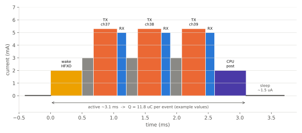

# 저전력 설계와 전류 프로파일

!!! spec "규격 · 버전"
    Core v6.0 Vol 6 Part B (Link Layer: 광고 간격·advDelay, 연결 간격, Peripheral Latency, 감독 타임아웃, 창 확장) · 전류 값 자체는 규격이 아니라 칩 데이터시트·측정으로 결정
    Core 4.0 LE 도입 → 4.2 DLE(긴 패킷으로 이벤트 수 감소) → 5.0 2M PHY(airtime 절반)·확장 광고 → 5.3 연결 서브레이팅 → 6.2 더 짧은 연결 간격(최소 375 µs, 125 µs 단위 — 지연↓·전력↑ 선택지)

!!! basic "한눈에 보기"
    LE 기기는 대부분의 시간을 **잠들어** 있고, 정해진 순간에만 몇 ms 깨어나 무선을 켭니다. 그래서 배터리 수명은 다음 두 가지로 거의 결정됩니다.

    1. **이벤트 한 번에 쓰는 전하**(µC) — 깨어남, 수신(RX), 송신(TX), CPU 처리가 차례로 이어진 전류 파형의 면적
    2. **이벤트가 얼마나 자주 오는가**(광고 간격, 연결 간격, Peripheral Latency) + 그 사이의 **수면 전류**

    평균 전류 ≈ (이벤트당 전하 ÷ 간격) + 수면 전류. 배터리 수명 ≈ 용량 ÷ 평균 전류.

## 전류 측정 장비와 방법 { .l2 }

| 장비 종류 | 예 | 장점 | 주의점 |
|---|---|---|---|
| 전원 겸 전류 분석기 (저가) | Nordic Power Profiler Kit II(PPK2), Joulescope, Otii 등 | nA–수십 mA를 자동 범위 전환으로 연속 측정, PC 파형 표시 | 범위 전환 순간의 왜곡, 샘플링 속도 확인 |
| 정밀 소스 측정 장치·DC 전원 분석기 | 계측기 제조사의 SMU·전원 분석기 | 높은 정확도, 배터리 시뮬레이션 | 고가 |
| 션트 저항 + 오실로스코프 | 1–10 Ω 션트 + 차동 프로브 | 빠른 파형 관찰 | 수면 µA 측정 부정확, 션트 전압강하 |
| 멀티미터 평균 | 일반 DMM | 간단 | µs 펄스를 평균 못 함 → 오판 쉬움 |

측정 요령은 다음과 같습니다.

- 디버거(SWD)와 UART 로그 연결을 끊습니다. 디버그 인터페이스가 켜져 있으면 수면 전류가 수백 µA까지 올라가기도 합니다.
- 샘플링 속도는 µs 단위 RX/TX 구간을 볼 수 있도록 높게(수십–수백 kS/s) 잡습니다.
- 평균은 최소 수십 개 이벤트 이상, 광고라면 advDelay 무작위성을 고려해 수 초 이상 적분합니다.
- 보드의 LED, 풀업 저항, 센서, 레귤레이터 대기 전류를 따로 측정해 빼 봅니다.

## 이벤트 전류 파형 구성 { .l2 }

<figure markdown>

<figcaption>레거시 광고 이벤트 1회의 예시 파형. 깨어남(고속 크리스털 기동) → 채널 37·38·39에서 램프업·송신(ADV_IND)·짧은 수신(SCAN_REQ/CONNECT_IND 대기) → CPU 후처리 → 수면. 전류 값은 설명용 가정이며 칩·송신 전력·DC-DC 사용 여부에 따라 크게 다릅니다.</figcaption>
</figure>

| 구간 | 하는 일 | 예시 가정 | 줄이는 방법 |
|---|---|---|---|
| 깨어남 | 저속 클럭으로 깨어나 고속 크리스털(HFXO) 안정 대기, 무선 준비 | 0.5 ms × 2 mA | 크리스털 기동 시간 짧은 부품, 스택의 사전 기동 시간 최적화 |
| 램프업 | PLL 고정, PA/LNA 켜기 | 채널당 0.18 ms × 3 mA | 칩 고유 — 선택 폭 작음 |
| TX | 패킷 송신 | 376 µs × 5.3 mA | 송신 전력↓, 짧은 패킷, 2M PHY |
| RX | 응답 대기·수신 | 144 µs × 5 mA | 연결에서는 정확한 SCA·짧은 창 확장 |
| 처리 | 스택·앱 처리, 플래시 쓰기 | 0.5 ms × 2 mA | 작업 몰아서 처리, 플래시 쓰기 최소화 |
| 수면 | RTC, RAM 유지 | 1.5 µA | RAM 유지 영역 축소, 주변장치 끄기 |

송신 구간 376 µs는 레거시 `ADV_IND`에 광고 데이터 31 B를 꽉 채운 경우입니다. PDU 페이로드 = AdvA 6 B + AdvData 31 B = 37 B, 1M PHY에서 (프리앰블 1 + 접근 주소 4 + 헤더 2 + 37 + CRC 3) B × 8 µs/B = 47 × 8 = **376 µs**입니다.

## 평균 전류와 배터리 수명 계산 { .l2 }

**광고 예 (레거시, 3채널, 광고 간격 1 s).**

1. 이벤트당 전하: 채널당 \(0.18 \times 3 + 0.376 \times 5.3 + 0.144 \times 5 = 0.54 + 1.99 + 0.72 \approx 3.25\ \mu\text{C}\) (ms × mA = µC)
2. 3채널 + 깨어남 + 처리: \(Q = 1.0 + 3 \times 3.25 + 1.0 \approx 11.76\ \mu\text{C}\)
3. 평균 간격: 광고 간격 1000 ms + advDelay 평균 5 ms = 1.005 s
4. 평균 전류: \(I = 11.76 / 1.005 + 1.5 \approx 11.70 + 1.5 = 13.2\ \mu\text{A}\)
5. 코인셀 220 mAh: \(220\ \text{mAh} / 0.0132\ \text{mA} \approx 16{,}667\ \text{h} \approx 694\ \text{일} \approx 1.9\ \text{년}\)
6. 코인셀은 펄스 부하·저온·자가 방전으로 실사용 용량이 줄어듭니다. 70 %만 쓸 수 있다고 보면 약 **1.3년**입니다.

| 광고 간격 | 평균 전류 | 220 mAh 수명 (이론) | 70 % 적용 |
|---|---|---|---|
| 100 ms | 113.5 µA | 81일 (0.22년) | 0.15년 |
| 500 ms | 24.8 µA | 370일 (1.01년) | 0.71년 |
| 1 s | 13.2 µA | 694일 (1.9년) | 1.33년 |
| 2 s | 7.36 µA | 1,245일 (3.41년) | 2.39년 |

**연결 예 (Peripheral, 빈 패킷 교환).** 이벤트당: 깨어남 0.3 ms × 2.5 mA (0.75 µC) + RX 0.25 ms × 5 mA (1.25 µC, 창 확장 포함, 빈 패킷 airtime 80 µs) + T_IFS 전환 0.15 ms × 3 mA (0.45 µC) + TX 80 µs × 5 mA (0.40 µC) + 처리 0.2 ms × 2 mA (0.40 µC) = **3.25 µC**.

| 실효 이벤트 간격 | 예 | 평균 전류 (수면 1.5 µA 포함) | 220 mAh 수명 (이론) |
|---|---|---|---|
| 7.5 ms | 최소 간격 (6.2 이전 기준) | 434.8 µA | 21일 |
| 30 ms | 빠른 응답이 필요한 기기 | 109.8 µA | 83일 |
| 100 ms | 센서 일반 | 34.0 µA | 270일 |
| 500 ms | 100 ms + Peripheral Latency 4 | 8.0 µA | 3.1년 |
| 1 s | 1 s 간격 | 4.8 µA | 5.3년 |

연결을 유지하는 것만으로는 데이터가 없으면 이처럼 광고보다 쌀 수 있습니다. 실제 수명은 데이터 전송, 센서, 플래시 쓰기를 더해 계산해야 합니다. 반복 계산은 [계산기](../reference/calculators.md)를 쓰면 편합니다.

??? expert "전문가 노트 — 창 확장, 코인셀, 레귤레이터"
    **창 확장(window widening).** Peripheral은 마지막 앵커 이후 흐른 시간만큼 양쪽 수면 클럭 오차를 고려해 수신 창을 넓힙니다. 대략 \(w = \frac{SCA_C + SCA_P}{10^6} \times t_{\text{since anchor}}\)이며, 예를 들어 합계 100 ppm에서 500 ms면 50 µs, Latency를 써서 2 s를 건너뛰면 200 µs로 늘어 RX 전하가 커집니다. 정확한 32.768 kHz 크리스털(±20 ppm 급)이 내부 RC 발진기보다 연결 전력에 유리한 이유입니다.

    **코인셀의 함정.** CR2032 같은 리튬 코인셀은 내부 저항이 커서 수 mA 펄스에서 전압이 크게 떨어집니다. 브라운아웃 리셋이 나면 "배터리가 남았는데 꺼짐" 증상이 됩니다. 수십–수백 µF 저 누설 커패시터로 펄스를 완충하고, 피크 전류를 낮추는 설정(낮은 송신 전력, DC-DC)을 함께 봅니다. 공칭 용량은 낮은 연속 부하 조건 값입니다.

    **DC-DC vs LDO.** 무선 구간에서 내부 DC-DC 변환기를 쓰면 같은 무선 전력에서 배터리 전류가 크게 줄어드는 칩이 많습니다. 다만 외부 인덕터가 필요하고, 레이아웃이 나쁘면 RF 스퓨리어스가 생길 수 있습니다.

    **연결 서브레이팅(5.3).** 평소에는 긴 간격으로 지내다 데이터가 생기면 연결 파라미터 갱신 절차 없이 빠른 간격으로 돌아올 수 있어, Latency만으로는 어려운 "저전력 + 빠른 응답"을 얻습니다. → [연결 이벤트와 파라미터](../le/connection-events.md)

## 파라미터 튜닝 표 { .l2 }

| 파라미터 | 늘리거나 켜면 | 전력 | 대가 |
|---|---|---|---|
| 광고 간격 | 20 ms → 1 s 이상 | 크게 감소 | 발견·연결 지연 증가 |
| 광고 데이터 길이 | 31 B → 필요한 만큼만 | TX 시간 감소 | 정보량 감소 (스캔 응답으로 분리) |
| 광고 채널 수 | 3 → 1–2 | 이벤트당 전하 감소 | 간섭에 약해짐 |
| 송신 전력 | +8 dBm → 0 dBm | TX 전류 감소 | 도달 거리 감소 |
| 연결 간격 | 7.5 ms → 수백 ms | 크게 감소 | 지연·처리량 감소 |
| Peripheral Latency | 0 → 4–10 | 데이터 없을 때 감소 | Central 쪽 명령 응답 지연 |
| 감독 타임아웃 | 짧게 ↔ 길게 | 직접 영향 작음 | 너무 짧으면 0x08 끊김 증가 |
| PHY | 1M → 2M | 같은 데이터에 airtime 절반 (251 B+MIC: 2120 → 1064 µs) | 감도·거리 감소 |
| DLE | 27 B → 251 B | 이벤트 수 감소, 헤더 오버헤드↓ | 패킷당 재전송 비용 증가 |
| 알림 묶음 전송 | 1개씩 → 모아서 | 깨어남 횟수 감소 | 데이터 지연 |

## 관련 페이지

- [저전력 설계 원리](../basics/low-power.md) — 듀티 사이클의 기본 개념
- [레거시 광고](../le/legacy-advertising.md) — 광고 간격과 advDelay
- [연결 이벤트와 파라미터](../le/connection-events.md) — 간격·Latency·타임아웃
- [LE PHY (1M·2M·Coded)](../le/phy.md) — PHY별 airtime
- [계산기](../reference/calculators.md) — 평균 전류·수명 계산
