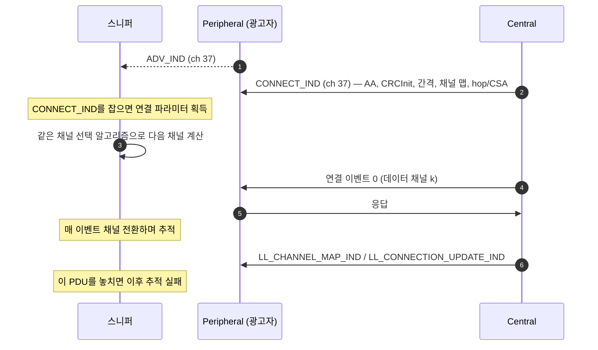

# 무선 스니퍼

!!! spec "규격 · 버전"
    해석 대상: Core v6.0 Vol 6 Part B (LE Link Layer: 광고·연결·채널 선택), Vol 6 Part E (LE 링크 계층 보안: AES-CCM), Vol 3 Part H (SMP), Vol 2 Part B (BR/EDR Baseband: 도약·패킷) · 스니퍼 자체는 규격 밖의 측정 장비
    Core 4.0 LE는 고정 광고 채널 3개 덕분에 저가 스니핑이 가능 → 5.0 2M·Coded PHY·확장 광고·CSA #2로 추적이 복잡해짐 → 5.2 ISO, 6.0 Channel Sounding으로 장비 요구가 더 높아짐

!!! basic "한눈에 보기"
    HCI 로그가 "Host와 칩 사이의 대화"라면, **스니퍼(sniffer)**는 공중을 날아다니는 실제 무선 패킷을 엿듣는 장비입니다.

    1. **LE 광고**는 채널 37/38/39 세 곳에서만 나오므로 비교적 쉽게 잡힙니다.
    2. **연결**은 매 이벤트마다 데이터 채널을 바꾸므로, 스니퍼가 연결 요청(`CONNECT_IND`)을 직접 봐야 같은 순서로 따라갈 수 있습니다.
    3. **암호화된 연결**은 키(LTK 또는 Classic 링크 키)를 알아야 내용을 풀 수 있습니다.
    4. **Classic**은 79개 채널을 초당 1600번 도약해서, 전 대역을 동시에 받는 고가 장비가 사실상 필요합니다.

## 스니퍼 종류 { .l2 }

| 종류 | 예 | 수신 방식 | 장점 | 한계 |
|---|---|---|---|---|
| 단일 채널 저가 동글 | **nRF Sniffer for Bluetooth LE** (nRF52840 Dongle·DK + Wireshark extcap) | 한 번에 한 채널, 연결 하나를 따라감 | 저렴, Wireshark 통합 | 놓친 `CONNECT_IND`는 복구 불가, 여러 연결 동시 추적 어려움 |
| 오픈 하드웨어 | Ubertooth One 등 | 한 채널 | 연구·교육용 | 최신 LE 기능·Classic 전체 추적에 한계 |
| 상용 광대역 분석기 | Ellisys, Teledyne LeCroy Frontline 계열 | 2.4 GHz 대역 전체를 동시에 디지털화 | 모든 채널·여러 연결·Classic·LE Audio 동시 캡처, HCI·오디오·Wi-Fi 등과 시간 동기 | 고가, 사용 교육 필요 |
| 칩 벤더 도구 | 각 SoC용 펌웨어 스니퍼 | 한 채널 | 자사 칩 디버깅 기능 | 기능 범위 다양 |

## 광고 따라가기와 연결 추적 { .l2 }

| 상황 | 단일 채널 스니퍼 결과 | 대응 |
|---|---|---|
| 광고 채널 3개 중 하나만 듣는 중 | 다른 채널의 `CONNECT_IND`를 놓침 | 광고 채널을 하나로 고정(시험 펌웨어)하거나 대상 주소 지정 후 3채널 순회 |
| 확장 광고 (`ADV_EXT_IND` → `AUX_ADV_IND`) | 보조 채널로 따라가야 함 | 확장 광고 추적을 지원하는 펌웨어 사용 |
| 이미 연결된 링크 | `CONNECT_IND`를 못 봤으므로 추적 불가 | 연결을 끊었다가 다시 연결시키며 캡처 |
| 연결 파라미터·채널 맵 갱신 | 갱신 PDU를 놓치면 다음 이벤트부터 엇나감 | 간섭이 적은 곳에서 대상 가까이 배치 |
| 2M / Coded PHY 전환 | 스니퍼가 해당 PHY를 지원해야 함 | 장비 지원표 확인 |
| 주소가 바뀌는 RPA | 광고 주소 필터가 어긋남 | IRK를 입력하거나 RSSI·내용으로 식별 |

스니퍼의 수신 실패와 실제 링크 실패를 구분해야 합니다. 스니퍼에 빈칸이 보여도 Central과 Peripheral은 정상 통신했을 수 있습니다. 결론을 내리기 전에 [HCI 로그](logs.md)의 연결 종료 이유와 대조합니다.

## 암호화된 링크 해독 { .l2 }

| 경우 | 해독에 필요한 것 | 비고 |
|---|---|---|
| LE 레거시 페어링 (Just Works, Passkey) | 페어링 과정 캡처 (+ Passkey) | TK 공간이 작아 캡처만으로 키 유도 가능 → 레거시 페어링이 약한 이유 |
| LE Secure Connections | **LTK** (또는 SC 디버그 키 사용 시 공개된 디버그 개인키) | ECDH라 공중 캡처만으로는 불가 |
| 이미 본딩된 재연결 | LTK + 암호화 시작 절차(`LL_ENC_REQ`/`LL_ENC_RSP`, `LL_START_ENC_REQ`) 캡처 | SKD·IV 교환을 봐야 세션 키 계산 가능 |
| Classic SSP | 링크 키 (+ 연결·인증 과정 캡처) | 상용 장비가 키 입력 기능 제공 |

LTK는 기기의 본딩 저장소(Linux: `/var/lib/bluetooth/<어댑터>/<기기>/info`, 개발 보드: 디버그 출력)에서 얻습니다. 양산 기기에서 키를 꺼낼 수 없다면, 시험 펌웨어에서 SC **디버그 모드**(SMP 디버그 키)를 켜는 방법이 있습니다. 디버그 키는 규격에 공개된 고정 키이므로 양산 펌웨어에는 절대 남겨 두면 안 됩니다.

??? expert "전문가 노트 — Classic 스니핑, ISO, 장비 동기화"
    **Classic이 어려운 이유.** BR/EDR 연결은 Central의 BD_ADDR(LAP·UAP)과 클럭으로 도약 순서를 정하고, 79개 채널을 625 µs 슬롯마다 바꿉니다. 단일 채널 수신기는 도약을 따라가려면 연결 수립(페이징) 순간부터 주소·클럭을 알아야 하고, AFH 채널 맵 변화까지 추적해야 합니다. 상용 장비는 대역 전체를 동시에 받아 이후 소프트웨어로 패킷을 재조립하는 방식으로 이를 피합니다. EDR(π/4-DQPSK, 8DPSK) 페이로드 복조도 필요합니다.

    **LE Audio·ISO.** CIS·BIS는 여러 하위 이벤트가 짧은 간격으로 이어지고, BIS 암호화는 Broadcast Code를 알아야 풀립니다. 실시간 오디오 품질 분석은 광대역 장비가 아니면 사실상 어렵습니다.

    **시간 동기.** 상용 분석기는 공중 패킷, HCI(UART·USB 탭), I2S 오디오, Wi-Fi, 전류 측정을 한 타임라인에 맞춥니다. 공존 문제나 "패킷은 나갔는데 앱이 늦게 받는다" 같은 문제는 이런 동기화된 뷰가 있어야 원인이 분리됩니다.

    **RSSI 해석.** 스니퍼가 보는 RSSI는 스니퍼 위치에서의 값입니다. 실제 링크의 수신 품질은 각 기기의 `HCI_Read_RSSI`나 패킷 오류율로 판단해야 합니다.

## Classic ↔ LE 비교

| 항목 | Classic (BR/EDR) | LE |
|---|---|---|
| 연결 전 탐색 | 조회(Inquiry) 32채널 도약 | 광고 채널 3개 고정 |
| 추적 시작점 | 페이징·FHS로 주소·클럭 획득 | `CONNECT_IND` |
| 도약 | 1600 홉/s, 79 채널 | 연결 이벤트마다 1회, 37 데이터 채널 |
| 저가 장비로 추적 | 사실상 어려움 | 가능 (연결 하나) |
| 해독 키 | 링크 키 | LTK (레거시 페어링은 캡처로 유도 가능) |

## 관련 페이지

- [로그 분석 (btmon·btsnoop·Wireshark)](logs.md) — HCI 쪽 기록과 대조
- [연결 수립](../le/connection.md) — `CONNECT_IND` 필드
- [채널 선택 알고리즘](../le/channel-selection.md) — 스니퍼가 따라 계산하는 것
- [LE 페어링과 본딩](../security/le-pairing.md) — 레거시 vs Secure Connections
- [조회와 페이징](../classic/inquiry-paging.md) — Classic 연결 수립
