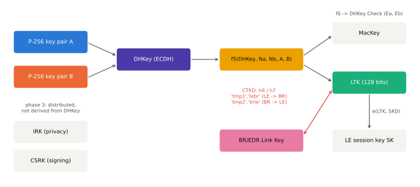

# 키 계층과 CTKD

!!! spec "규격 · 버전"
    Core v6.0 Vol 3 Part H (SMP — 키 분배, 함수 h6/h7, 키 길이) · Vol 2 Part H (BR/EDR Link Key, 암호 키 길이 협상) · Vol 6 Part E (LE 세션 키 유도) · Vol 4 Part E (HCI)
    4.0 LTK·IRK·CSRK·EDIV/Rand → 4.2 LE SC(LTK 직접 유도), CTKD(h6) → 이후 h7·CT2 비트 추가 → 5.1 CTKD 키 덮어쓰기 제한 → 5.3 BR/EDR 최소 키 길이 제어

!!! basic "한눈에 보기"
    페어링의 목적은 결국 **여러 개의 키**를 얻는 것입니다. 키마다 맡은 일이 다릅니다.

    - **LTK**(Long Term Key): 다음 연결부터 링크를 암호화할 때 쓰는 핵심 키
    - **IRK**(Identity Resolving Key): 계속 바뀌는 랜덤 주소(RPA)가 "아는 그 기기"인지 알아보는 키
    - **CSRK**(Connection Signature Resolving Key): 암호화하지 않은 데이터에 서명을 붙이는 키
    - **Link Key**: Classic(BR/EDR)에서 LTK 역할을 하는 키

    **CTKD**(Cross-Transport Key Derivation)는 LE에서 페어링해 얻은 LTK로 Classic Link Key를 계산하거나 그 반대를 하는 기능입니다. 이어폰처럼 Classic과 LE를 모두 쓰는 기기에서 페어링을 한 번만 하게 해 줍니다.

## 키 종류 { .l2 }

<figure markdown>

<figcaption>LE Secure Connections에서 ECDH로 만든 DHKey가 f5를 거쳐 MacKey와 LTK가 되고, LTK는 매 연결의 세션 키와 CTKD(h6/h7)로 BR/EDR Link Key를 만드는 데 쓰입니다. IRK와 CSRK는 DHKey에서 유도되지 않고 페이즈 3에서 따로 배포됩니다.</figcaption>
</figure>

| 키 | 크기 | 만들어지는 곳 | 쓰임 | 비고 |
|---|---|---|---|---|
| **TK** | 128비트 | Legacy 페어링 입력 (0, passkey, OOB) | STK 계산 | LE Legacy 전용 |
| **STK** | 128비트 | s1(TK, Srand, Mrand) | 페이즈 2–3 동안 링크 암호화 | LE Legacy 전용, 저장하지 않음 |
| **LTK** | 키 길이만큼(최대 128비트) | Legacy: 배포 / SC: f5 | 재연결 암호화 | SC에서는 양쪽이 같은 LTK |
| **EDIV, Rand** | 16비트, 64비트 | Legacy 페이즈 3 배포 | 여러 LTK 중 어떤 것인지 식별 | SC에서는 0 |
| **IRK** | 128비트 | 기기마다 고정, 배포 | RPA 생성·해석 | 신원 주소와 함께 배포 |
| **CSRK** | 128비트 | 배포 | 서명된 쓰기(`Signed Write Command`) | AES-CMAC, SignCounter로 재전송 방지 |
| **Link Key** | 128비트 | LMP 페어링(SSP) 또는 CTKD | BR/EDR 인증·암호 키 유도 | 키 종류로 인증 여부 표시 |
| **세션 키 SK** | 128비트 | e(LTK, SKD) — SKD는 양쪽이 낸 난수 | 해당 연결의 AES-CCM 암호화 | 연결마다 새로 |

**페이즈 3 키 분배**는 Pairing Request/Response의 Key Distribution 비트로 정합니다. 개시자와 응답자가 각각 "내가 줄 키"와 "상대가 줄 키"를 제안하고, 응답자가 그중 일부만 수락합니다. LE SC에서는 EncKey 비트가 LTK 배포를 뜻하지 않고 무시됩니다(LTK를 이미 양쪽이 계산함).

## CTKD (Cross-Transport Key Derivation) { .l2 }

CTKD는 **Secure Connections로 만든 키**에만 허용됩니다(LE SC의 LTK, 또는 P-256 Link Key). 레거시 키로는 다른 전송의 키를 만들지 않습니다. 함수는 둘입니다.

- \( h6(W, keyID) = \mathrm{AES\text{-}CMAC}_W(keyID) \)
- \( h7(SALT, W) = \mathrm{AES\text{-}CMAC}_{SALT}(W) \) — Pairing Request/Response의 **CT2** 비트가 양쪽 1이면 중간 키를 h7로 만듦

| 방향 | 진행 위치 | 중간 키 | 최종 키 |
|---|---|---|---|
| LE → BR/EDR | LE SMP 페이즈 3 (LinkKey 비트) | ILK = h7(SALT, LTK) 또는 h6(LTK, "tmp1") | Link Key = h6(ILK, "lebr") |
| BR/EDR → LE | BR/EDR 위의 SMP (L2CAP CID `0x0007`) | ILTK = h7(SALT, Link Key) 또는 h6(Link Key, "tmp2") | LTK = h6(ILTK, "brle") |

유도된 키는 원래 키의 **인증 여부를 물려받습니다**. Just Works로 만든 LTK에서 나온 Link Key는 "인증되지 않은 P-256" 키가 됩니다. BR/EDR → LE 방향에서는 IRK와 CSRK도 BR/EDR 위의 SMP로 함께 배포할 수 있습니다.

??? expert "전문가 노트 — CTKD와 키 덮어쓰기(BLURtooth)"
    **문제.** CTKD는 한 전송에서 페어링한 결과로 **다른 전송의 기존 키를 덮어씁니다**. 그래서 이미 강한(인증된) 키로 본딩된 상대가 있는데 공격자가 다른 전송에서 Just Works로 새로 페어링하면, 그 결과가 기존 키를 대체할 수 있었습니다(2020 BLURtooth, CVE-2020-15802).

    **대응.** Bluetooth SIG는 Core 5.1부터 특정 상황에서 키 덮어쓰기를 막는 장치가 규격에 있다고 설명했습니다. 구현 쪽 원칙은 ① 기존 키보다 **약한(인증 수준이 낮거나 키가 짧은)** 키로 덮어쓰지 않기, ② CTKD 결과를 반영하기 전 사용자 확인, ③ 필요 없으면 CTKD(LinkKey 분배 비트)를 끄기입니다.

    **h7 지원 확인.** CT2 비트가 한쪽이라도 0이면 h6 경로를 씁니다. 두 구현이 서로 다른 경로를 쓰면 키가 달라져 다음 연결의 암호화가 실패하므로, 상호 운용 시험 때 자주 확인하는 항목입니다.

## 암호 키 길이 { .l2 }

키 길이는 페어링(LE) 또는 LMP 협상(BR/EDR)에서 정하며, 128비트보다 짧으면 유도된 키의 상위 바이트를 0으로 채워 엔트로피를 줄입니다. 원래는 수출 규제 대응용이었지만 지금은 공격 표면이 되었습니다.

| 항목 | LE | BR/EDR |
|---|---|---|
| 협상 위치 | SMP `Maximum Encryption Key Size` (호스트) | LMP `LMP_encryption_key_size_req` (컨트롤러) |
| 허용 범위 | 7–16 옥텟 | 원래 1–16 옥텟 → KNOB 이후 정오표로 최소 7 옥텟 |
| 호스트가 알아내는 법 | 페어링 결과로 직접 앎 | `HCI_Read_Encryption_Key_Size`, 5.3부터 `HCI_Encryption_Change` [v2] 이벤트에 포함 |
| 호스트가 하한을 거는 법 | 호스트 정책(예: 16 미만 거부) | 5.3 `HCI_Set_Min_Encryption_Key_Size` |
| 권장 | 16 옥텟 | 16 옥텟, Secure Connections Only 모드 |

Core 5.3의 **암호 키 길이 제어(Encryption Key Size Control)** 는 BR/EDR의 키 길이 협상이 컨트롤러끼리 이루어져 호스트가 개입할 틈이 없던 문제를 다룹니다. 호스트가 받아들일 최소 길이를 컨트롤러에 미리 지정하고, 암호화가 바뀔 때 이벤트로 실제 키 길이를 바로 받습니다.

## Classic ↔ LE 비교

| 항목 | Classic (BR/EDR) | LE |
|---|---|---|
| 장기 키 | Link Key (컨트롤러가 계산, 호스트에 `HCI_Link_Key_Notification`) | LTK (호스트 SMP가 계산·저장) |
| 키 식별 | BD_ADDR | Legacy: EDIV·Rand / SC: 주소 |
| 프라이버시 키 | 없음(주소 고정) | IRK |
| 서명 키 | 없음 | CSRK |
| 세션 키 | E3 또는 SC의 h3 유도 | e(LTK, SKD) |

## 관련 페이지
- [LE 페어링과 본딩](le-pairing.md) — 키를 만드는 절차
- [프라이버시와 RPA](privacy.md) — IRK의 쓰임
- [Classic 보안 (SSP)](classic-security.md) — Link Key 종류
- [알려진 공격과 대응](attacks.md) — KNOB, BLURtooth
